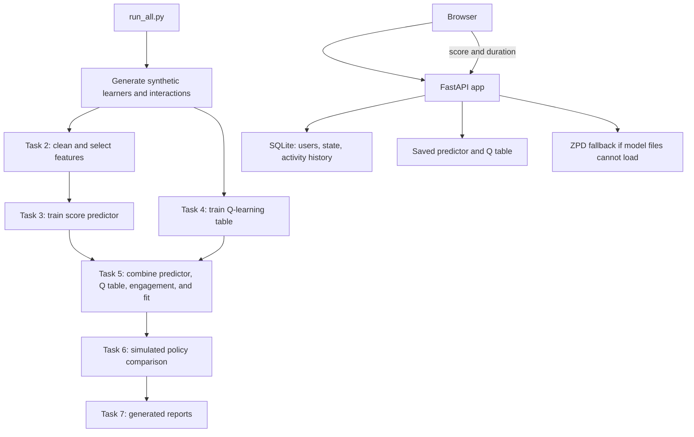

# Project Report: AI Learning Path Optimizer

**Inspection date:** 2026-10-10

**Project folder:** repository root

> **Current status (Phase S stabilization):** Multi-subject content, per-subject state, subject routes, teacher content routes, and the generalized simulator/recommender are implemented. The training pipeline has now been run in this checkout after backing up the prior model artifacts; `/ready` reports `hybrid`. Phase S also added recommendation recency/coverage ranking, a database index, responsive layout and error feedback improvements. The fresh validation run still found high latency at 100 concurrent simulated users and moderate axe landmark violations; see [docs/VALIDATION_REPORT.md](docs/VALIDATION_REPORT.md). The simulator uses synthetic learners; no results prove real learning gains. No learner account name, password hash, or signing secret is included in this report.

### Findings fixed or addressed in Phases 1–4 and security follow-up

| Original finding | Current status |
|---|---|
| Quiz submit button targeted a missing ID | Fixed: `static/index.html` now provides `submit-activity`, which `static/app.js` uses. The browser-flow test exercises submission. |
| Browser supplied a score the server trusted | Fixed: browser submits selected answers; `app/services/quiz.py:grade_answers()` grades them on the server. Duration is range-limited to 0.5–120 minutes, though still client-reported. |
| Authentication routes were in the package initializer | Fixed: routes are implemented in `app/routes/auth.py`; `app/routes/__init__.py` is a package marker. |
| Chart.js required an internet CDN | Fixed: Chart.js and its license are bundled under `static/`. |
| Runtime manifests were incomplete and unpinned | Fixed: direct packages have exact pins in `requirements.txt` and `requirements-server.txt`. Transitive packages are not locked. |
| Weak password handling and a fixed fallback signing key | Improved: production requires a private 32-character `APP_SECRET`; passwords have minimum/content rules and an enforced 72-byte maximum. Development without a configured secret uses a temporary process-only random key. |
| No refresh-token revocation, duplicate-name handling, or login rate limit | Fixed: refresh rotation/revocation, clean HTTP 409 duplicate handling, and five-per-minute registration/login limits are implemented. |
| No configured security headers, CORS allowlist, SQLite foreign-key enforcement, or schema migration | Fixed: headers and configured CORS are enabled, SQLite foreign keys are enabled for each connection, and Alembic migration exists. Backups remain an operator responsibility. |
| No account data deletion path | Fixed: `DELETE /api/account` checks the current password and removes user state, interaction history, and refresh tokens. |
| Account-deletion password guessing was not rate-limited | Fixed after Phase 4.5: the deletion route now has a five-per-minute limit; the sixth bad password attempt returns HTTP 429. |
| Vulnerable `python-jose`/`ecdsa` packages were used for tokens | Fixed after Phase 4.5: token handling uses PyJWT; current `pip-audit` reports no known vulnerabilities. |
| Runtime Q-table loading used pickle deserialization | Fixed after Phase 4.5: Q tables use validated JSON; the legacy pickle artifact was removed. |
| Bandit findings for a swallowed exception and a hardcoded-secret-pattern match | Fixed after Phase 4.5: exception handling is narrowed, and production rejects the old secret by digest. The follow-up Bandit scan reports zero findings. |
| Dynamic browser values were rendered as HTML | Fixed for current dynamic UI values: the browser uses DOM text APIs and node creation. |
| No automated test coverage or browser-flow check | Fixed: pytest API/service/browser tests exist; pytest enforces at least 80% app coverage. Tests use temporary SQLite databases. |
| No consistent request metadata or health routes | Fixed: JSON request metadata logging, `/health`, and `/ready` are implemented. |
| No project-authored setup and developer docs | Addressed in Phase 4: README, architecture, API, data, security, contribution, and changelog documentation were added. |
| No automated capture-ready UI screenshots | Addressed in Phase 4: a Playwright helper captures the sign-in, dashboard, and quiz screens using an isolated temporary database. |
| Learning content and learner state were hard-coded for one subject | Fixed in Phase M source: content packs define subjects, topics, prerequisites, resources, and questions; state is scoped by learner and subject. The initial Mathematics state is migrated by Alembic. |
| No subject enrollment, switching, diagnostic, or topic-level explanation | Implemented in Phase M: subject enrollment/switching, progress, a per-topic diagnostic, prerequisite-aware topic map, and recommendation explanation are exposed in the API and UI. |
| Only students and no teacher content controls | Teacher role and content-write endpoints were added. **Security limitation remains:** public self-registration accepts the teacher role, so this is not safe provisioning for a shared deployment. |
| Simulator and features depended on the Mathematics topic set | Generalized simulator source creates multiple random prerequisite graphs; model features describe the candidate topic, prerequisite mastery, difficulty gap, engagement, trend, attempts, type, and time. Phase S reran the pipeline after backing up the prior artifacts; the regenerated models load in `hybrid` mode as confirmed by `/ready`. |
| Optimizer did not encourage coverage for low-mastery or low-engagement profiles | A coverage term is present in the source ranking and Task 5/6 report generators, and Task 6 records simulated group gaps. The checked-in models and generated Task 5–7 reports have been regenerated for the current schema. This is not a fairness guarantee. |

### Findings that remain open

- The recommendation training and policy evaluation use simulated learners. They do not establish real learning gains.
- Resource types are catalogue labels, not actual hosted videos/articles. The three included packs each have six topics and eight draft questions per topic; questions need teacher review.
- The web UI shows per-subject recommendations, a topic map, diagnostic, progress, and rationale; it does not present the offline pipeline's multi-step planned path.
- Fairness coverage and group-gap metrics are simulation heuristics/measurements only. They do not prove fairness or real educational benefit.
- At 100 simulated users, local request latency remains high even after model caching and database query/index improvements. See the before/after measurements and limitations in [docs/VALIDATION_REPORT.md](docs/VALIDATION_REPORT.md).
- Public teacher self-registration allows anyone to edit shared subject content; restrict teacher provisioning before deployment.
- New content-pack import is transactional and idempotent for matching IDs, but content changes still require review and a database backup.
- Access and refresh tokens are held in browser `localStorage`; an unexpired access token cannot be revoked by logout. There is no account recovery or email verification.
- Rate limits are process-local and have not been configured for multiple workers behind a proxy. SlowAPI currently emits deprecation warnings in this environment.
- SQLite is the default local store. PostgreSQL deployment, automated backups, TLS setup, production hosting, and CI workflows remain future work.
- There are no real learner data, privacy/consent program, secure teacher provisioning/audit trail, or validated accessibility review.
- The TensorFlow requirement is pinned to a release-candidate version, and package/platform compatibility can vary.
- Predictor joblib/Keras artifacts must remain trusted; there is no artifact signing or integrity verification. The Q table uses validated JSON.
- No license has been selected and there is no `LICENSE` file.

## Scope and method

I read the project’s Python source, browser files, dependency manifests, generated reports and model metadata, and inspected the local SQLite schema without reading account names or password hashes. I inventoried the installed Python packages in `.venv`; `.venv-1` is a second, mostly empty Python environment. Compiled Python cache files were identified as generated files. The two virtual environments contain third-party interpreter and package files, so those vendor files are summarized by environment and package list rather than described one by one. The initial inspection was read-only. Phase 1 then changed application source and dependency files. In the later security follow-up, the legacy `outputs/models/q_table.pkl` was removed after replacing it with a generated JSON artifact.

## 1. Project overview

This project is a personalized learning-path demo. It simulates learners, generates practice-history data, trains a model to predict quiz scores, and uses reinforcement learning plus rules to rank learning activities. It also includes a small website where a learner can register, view a mastery chart, see recommendations, and log quiz results. The training and evaluation use simulated learners, so the reported results do not show that the recommendations improve learning in a real classroom.

The intended users are learners who want a recommended next activity and developers or educators exploring adaptive-learning ideas. The project type is a **Python machine-learning and reinforcement-learning pipeline plus a browser website and JSON API**. It is not a mobile app, and it does not contain a real course or a real learning-resource library.

## 2. Tech stack

### Languages

- **Python** — data generation, model training, recommendation logic, API, and SQLite access. The active `.venv` uses Python **3.14.7**.
- **JavaScript** — browser behavior, sign-in, charts, quizzes, and API requests in `static/app.js`.
- **HTML** — page structure in `static/index.html`.
- **CSS** — layout and responsive styling in `static/styles.css`.

### Main frameworks and libraries

The versions below are from the active `.venv` package inventory on the inspection date. Phase 1 pins the direct dependencies to these exact versions in both requirements files.

- **FastAPI 0.143.0** — defines the HTTP API and serves the web application.
- **Uvicorn 0.54.0** — runs the FastAPI app as a local web server.
- **SQLAlchemy 2.1.4** — maps Python classes to database tables and builds database queries.
- **SQLite** — stores accounts, learner state, and activity history in `outputs/app.db`.
- **Pydantic 2.14.0** — checks the shape and basic ranges of API request data.
- **PyJWT 2.15.1** — creates and checks signed login tokens.
- **bcrypt 5.0.0** — hashes passwords before they are stored.
- **NumPy 2.5.3** — arrays, calculations, random numbers, and learner simulation.
- **pandas 3.0.6** — tables for generated learner histories and features.
- **scikit-learn 1.9.1** — feature selection, scaling, PCA, model metrics, and the MLP fallback.
- **TensorFlow 2.22.0rc0 / Keras nightly** — trains and serves the neural-network score predictor. The installed TensorFlow is a release candidate, not a normal final release.
- **SciPy 1.18.1** — paired statistical test in `src/task6_evaluation.py`.
- **Matplotlib 3.11.2** — creates the training and evaluation charts.
- **joblib 1.6.0** — saves and loads scikit-learn pipeline/model objects.
- **Chart.js 4.4.0** — draws the mastery chart in the browser. The library and its MIT license are bundled under `static/`, so the chart no longer needs a CDN connection.

### Dependency and environment files

- `requirements.txt` contains both ML and web dependencies. This is the broad manifest needed for a full local run.
- `requirements-server.txt` now includes the server's NumPy, pandas, and model-serving dependencies and pins exact versions.
- Both requirements files use exact direct-dependency pins. There is still no lockfile for transitive packages.
- `.venv` contains the working Python 3.14.7 environment. `.venv-1` is another Python 3.14.7 environment with no packages shown by `pip freeze`; it appears redundant or incomplete.

## 3. Folder and file structure

```text
ai_learning_path_optimizer/
├── .gitignore                      # Ignores virtualenvs, caches, local DB, and .env
├── run_all.py                      # Runs the offline ML/RL/report pipeline
├── run_server.py                   # Starts Uvicorn on 127.0.0.1:8000
├── requirements.txt                # ML + web package requirements
├── requirements-server.txt         # Pinned server and model-runtime dependencies
├── requirements-dev.txt            # Pinned tests and quality tools
├── README.md                       # Beginner quick start and project status
├── PROJECT_REPORT.md               # This report
├── src/                            # Synthetic data, simulation, ML and evaluation
│   ├── config.py                   # Constants and output-folder creation
│   ├── data_generation.py          # Synthetic interaction data
│   ├── domain.py                   # Topics, resources, student population, math helpers
│   ├── env.py                      # Simulated learner and Q-learning state conversion
│   ├── task1_problem_analysis.py   # Writes the problem-definition report
│   ├── task2_preprocessing.py      # Features, splits, scaling, selection, PCA
│   ├── task3_model.py              # TensorFlow/MLP score prediction and evaluation
│   ├── task4_qlearning.py          # Tabular Q-learning
│   ├── task5_optimizer.py          # Hybrid recommendation and sample path
│   ├── task6_evaluation.py         # Compares five policies in simulation
│   ├── task7_conclusion.py         # Writes the final generated report
│   ├── utils.py                    # Seeds, plots, Gini, banners
│   └── __init__.py                 # Empty Python package marker
├── app/                            # FastAPI site and API
│   ├── main.py                     # FastAPI object, static site, middleware, health routes
│   ├── config.py                   # Environment-backed application settings
│   ├── database.py                 # SQLite engine and DB sessions
│   ├── models_db.py                # User, learner-state, and interaction tables
│   ├── schemas.py                  # API request/response validation
│   ├── security.py                 # bcrypt password functions and JWT functions
│   ├── dependencies.py             # Checks bearer token and finds the logged-in user
│   ├── routes/
│   │   ├── __init__.py             # Route package marker
│   │   ├── auth.py                 # Registration and login endpoints
│   │   └── learning.py             # State, recommendation, catalog, interaction, history API
│   └── services/
│       ├── learning.py             # Updates a learner profile after a submitted score
│       ├── quiz.py                 # Server-side quiz questions and grading
│       └── recommender.py          # Loads model artifacts or uses rule-based fallback
├── static/
│   ├── index.html                  # Login, dashboard, and quiz modal markup
│   ├── app.js                      # Browser logic and API calls
│   ├── chart.umd.min.js            # Locally bundled Chart.js 4.4.0
│   ├── chartjs-LICENSE.md          # Chart.js MIT license
│   └── styles.css                  # Visual styling and small-screen layout
├── migrations/                     # Alembic schema history
├── tests/                           # API, service, and browser tests
├── docs/                            # Project, API, data, architecture, and security guides
├── scripts/                         # Screenshot capture helper
├── outputs/                        # Generated data, model files, charts, reports, app DB
│   ├── app.db                      # Local SQLite database
│   ├── data/
│   │   ├── catalog.csv             # 30 simulated resources
│   │   ├── students.csv            # 400 synthetic learners
│   │   ├── interactions.csv        # 16,000 generated interaction rows
│   │   └── processed.npz           # Train/validation/test arrays and student IDs
│   ├── models/
│   │   ├── pipeline.joblib         # Task 2 fitted feature pipeline
│   │   ├── q_table.json            # Learned state/action values
│   │   └── predictor/              # Predictor model, metadata, and pipeline copy
│   ├── plots/                      # Seven generated PNG charts
│   └── reports/                    # Task 1–7 generated Markdown reports
├── .venv/                          # Active third-party Python environment
├── .venv-1/                        # Second, apparently incomplete environment
└── __pycache__/                    # Generated Python bytecode caches
```

### Files or items worth calling out

- `README.md` now documents setup and project status. Detailed guides are in `docs/`.
- Authentication handlers are now in `app/routes/auth.py`; `app/routes/__init__.py` is just a package marker.
- `app/__init__.py`, `app/services/__init__.py`, and `src/__init__.py` are empty package marker files. They contain no behavior; they are harmless and conventional in many Python projects.
- `outputs/models/pipeline.joblib` and `outputs/models/predictor/pipeline.joblib` contain copies of the feature pipeline. This duplication appears intentional: Task 2 saves a pipeline, then Task 3 packages a copy next to the predictor.
- `outputs/` is generated runtime data, not source. `run_all.py` can regenerate or overwrite most of it. `outputs/app.db` is live local account/activity storage and is not a model artifact.
- `.venv` and `.venv-1` are machine-specific environments, not application source. Python cache files are also generated and can be recreated.
- Tests, a migration, and `.env.example` are present. Docker, CI, and a transitive dependency lockfile remain absent.

## 4. How it works (step by step)

There are two entry points: `run_all.py` for training and analysis, and `run_server.py` for the website.

### Offline training and analysis flow

1. `run_all.py` sets random seeds and calls Task 1 to write a description of the problem.
2. `src/data_generation.py:main()` creates 400 synthetic learners and 40 activities for each learner. `behavior_policy()` chooses a weak-topic activity most of the time, with some random exploration. The result is 16,000 rows in `outputs/data/interactions.csv`.
3. `src/task2_preprocessing.py:main()` splits rows by student: 240 students for training, 60 for validation, and 100 for testing. It builds numeric and one-hot features, fits scaling and selection on training data, and saves arrays and pipeline artifacts.
4. `src/task3_model.py:main()` tests six neural-network configurations, picks the best validation score, evaluates once on the held-out test rows, saves the predictor, and writes plots and metrics.
5. `src/task4_qlearning.py:main()` trains a table of values for state/action pairs over 2,500 simulated episodes, then saves it as `q_table.json`.
6. `src/task5_optimizer.py:main()` combines predicted score, learned Q value, estimated engagement, and difficulty fit. It prints an example recommendation and an 8-step simulated plan.
7. `src/task6_evaluation.py:main()` compares five policies for 100 test-split learners over 30 simulated steps and writes summary statistics and a chart.
8. `src/task7_conclusion.py:main()` turns evaluation results into a final Markdown report. `run_all.py` prints the headline results and artifact paths.

### Website flow

1. `run_server.py` asks Uvicorn to load `app.main:app` on local address `127.0.0.1`, port `8000`.
2. `app/main.py` mounts the static folder, includes routers and middleware, and serves `static/index.html` at `/`. Run `alembic upgrade head` to create or upgrade the database schema; the server does not create tables on startup.
3. The browser JavaScript registers or logs in through `/api/auth/register` or `/api/auth/login`. The server hashes the password and returns a signed token.
4. The browser stores that token in `localStorage` and sends it as a Bearer token on protected API calls.
5. `/api/recommend` reads the user’s saved state. `app/services/recommender.py:recommend_for()` uses the trained TensorFlow/Q-table hybrid if its files load; otherwise it ranks activities with a ZPD rule.
6. The learner opens a recommendation. The browser requests questions from `/api/quiz/{action}`, then sends selected option indexes and elapsed time to `/api/interaction`.
7. `app/services/quiz.py:grade_answers()` calculates the score on the server. `app/services/learning.py:apply_interaction()` updates estimated mastery and engagement. `app/routes/learning.py:log_interaction()` saves the state and an `Interaction` row. The dashboard then reloads mastery, recommendations, and history.

The submit-button mismatch is fixed. A Playwright test covers registration, login, quiz submission, history, and logout.

### Simple flow diagram



## 5. Features

### Implemented in code

- Generates a deterministic catalogue of 30 resources: six math topics multiplied by five resource types.
- Simulates 400 learners with different ability, motivation, and starting mastery.
- Generates synthetic activity logs, splits by student, prepares features, selects features, and studies PCA variance.
- Trains a TensorFlow/Keras score predictor, with an MLPRegressor fallback if TensorFlow cannot be imported.
- Trains tabular Q-learning and saves its learned action values.
- Ranks candidate resources with a four-part hybrid score and can create an 8-step simulated plan.
- Evaluates static, behavior, ZPD, Q-learning, and hybrid policies in the simulated environment.
- Provides account registration and login, signed login tokens, a mastery dashboard, recommendations, a fixed quiz bank, activity history, and a local SQLite store.
- Falls back to a rule-based ZPD recommender if trained model assets are missing or fail to load.

### Partial, misleading, or broken features

- **Quiz grading is server-side:** `app/services/quiz.py` holds the answer key, and the browser sends selected option indexes. The flow needs an end-to-end browser test.
- **Resources are labels, not learning content:** a “video,” “article,” “interactive,” or “project” recommendation does not open that type of content. Each type leads to the same small quiz bank for its topic.
- **The browser shows one recommended next activity plus alternatives.** The multi-step path is printed by the offline Task 5 demo; it is not exposed as a path in the web API or dashboard.
- **Duration is self-reported by the browser.** The API bounds it to 0.5–120 minutes, but a user can still change it within those limits.
- **Fairness is measured, not optimized.** Task 6 reports group gaps, but `PersonalizedPathOptimizer` has no fairness term in its four score components. The Task 7 language about fairness benefits is not demonstrated as a fairness constraint.
- **“Held-out” has limits:** the predictor’s test split is by student, but Task 4 Q-learning draws training episodes from the full synthetic student population. The policy comparison is also only in this simulator.
- **The optimizer uses predicted score as one part of utility.** A high predicted quiz score is not necessarily the same as a high learning gain.
- The quiz questions are served by the backend, but the question bank and learning resources remain small and fixed.

## 6. Data and storage

### Files generated by the ML pipeline

- `outputs/data/interactions.csv`: 16,000 synthetic activity rows with score, gain, engagement, action, topic/resource features, and student ID.
- `outputs/data/students.csv`: 400 synthetic learner profiles.
- `outputs/data/catalog.csv`: 30 simulated resources with topic, type, difficulty, duration, and learning/engagement parameters.
- `outputs/data/processed.npz`: train/validation/test feature arrays, labels, and student IDs. Current shapes are 9,600 training rows, 2,400 validation rows, and 4,000 test rows, each with 15 selected features.
- `outputs/models/`: joblib pipeline copies, a Keras model, JSON model metadata, and a JSON Q table.
- `outputs/plots/` and `outputs/reports/`: generated PNG charts and Task 1–7 Markdown reports.

The inputs for the ML process are generated from rules in `src/domain.py`, `src/env.py`, and `src/data_generation.py`. No real student data source is connected.

### SQLite database

The local database is `outputs/app.db`. Its schema has four tables:

- `users`: `id` primary key, unique `username`, `hashed_password`, and creation time.
- `student_states`: `user_id` is both primary key and foreign key to `users.id`; stores ability, motivation, mastery estimates, topic attempts, recent scores, total time, engagement, last score/difficulty, and interaction count. The JSON-shaped values are stored as text.
- `interactions`: `id` primary key and `user_id` foreign key; stores chosen action, topic, resource type, difficulty, duration, score, gain, engagement, and timestamp. One user can have many interaction rows.
- `refresh_tokens`: token ID primary key and user foreign key; stores refresh-token expiry and revocation state.

Alembic manages the schema, and SQLite foreign-key checks are enabled for each connection. This report does not include local account names or password hashes.

### External services

There is no external model API, cloud database, or third-party learning platform. Chart.js is served locally from `static/`. The rest of the model and API work locally.

## 7. How to run it

### Full setup from a clean checkout

From the project root, create and activate a virtual environment, install the full requirements, then train/generate artifacts before launching the site:

```bash
python3.14 -m venv .venv
source .venv/bin/activate
python -m pip install --upgrade pip
python -m pip install -r requirements.txt
cp .env.example .env
python run_all.py
alembic upgrade head
python run_server.py
```

Open `http://127.0.0.1:8000`. FastAPI’s automatic API documentation is at `/docs`. Keep the generated `APP_SECRET` private and stable while using the same database; changing it invalidates existing login tokens.

`python run_all.py` regenerates synthetic data, retrains models, redoes Q-learning, and rewrites reports and plots. It took about 65 seconds in the inspected environment. If compatible saved artifacts are already present, the server can try to load them without rerunning training.

### Important setup notes and likely errors

- `requirements-server.txt` lists the packages needed by the API and saved hybrid model. Direct dependencies are pinned.
- If port `8000` is occupied, Uvicorn cannot bind. Stop the other process or change the port in `run_server.py`.
- If the model artifacts are missing or incompatible, the recommender tries to use its ZPD fallback. That fallback still needs NumPy and pandas.
- Chart.js is now served locally from `static/chart.umd.min.js`.
- In development, a missing `APP_SECRET` creates a random process-only key; production refuses to start without a strong configured secret.
- `.env.example` documents local settings; `.env` is loaded automatically only in development.
- The current environment has Python 3.14.7 and TensorFlow 2.22.0rc0. Direct dependencies are pinned, but transitive dependencies are not locked and platform compatibility can vary.

## 8. Code quality review

### Bugs and correctness risks

- **Fixed in Phase 1: quiz submit button and score trust.** The submit button now has the ID used by JavaScript. The browser sends selected answers; `grade_answers()` calculates the score on the server. Duration is still supplied by the client, although it is range-limited.
- **Fixed in Phase 2: secret and password checks.** Production requires a configured strong secret. Registration rejects short, all-digit, common-list, and over-72-byte passwords instead of silently truncating.
- **Improved in Phase 2: token handling.** Access tokens last 15 minutes by default. Refresh tokens last seven days, rotate, and can be revoked. Tokens remain in browser `localStorage`, and logout does not revoke an already-issued access token before it expires.
- **Fixed in Phase 2: duplicate registration race.** A database uniqueness conflict is rolled back and returned as HTTP 409.
- **Medium: evaluation claims are stronger than the evidence.** All learners and outcomes are simulated. The Q table is trained using the synthetic population, including students later selected for the test set. The p-value only describes paired results in this hand-built simulator.
- **Medium: fairness is not an optimizer objective.** The code measures group gaps but has no group-aware term or guardrail.
- **Fixed in Phase 1: dependency manifests.** Both requirement files now pin exact direct versions, and the server manifest includes the model runtime dependencies.
- **Improved in Phase 1: quiz score integrity.** The server checks option indexes and calculates the score. It cannot verify the client-reported duration or whether an activity was among the latest recommendations.
- **Fixed in Phase 1: listed dead code.** The specific dead branches and unused imports/variables from the original inspection were removed.
- **Fixed in Phase 1: auth route placement.** Registration and login now live in `app/routes/auth.py`.
- The code uses SQLAlchemy query APIs, not handwritten SQL string concatenation; there is no obvious SQL-injection path in the inspected routes.

### Security and operations

- Registration, login, and account deletion are rate-limited; refresh tokens can be revoked. Account recovery, email verification, a full audit log, and administrator roles are not implemented. SlowAPI deprecation warnings were observed in this environment.
- The app listens on `127.0.0.1`, which is local-only by default, and has no TLS/deployment configuration. A public deployment would need a secure reverse proxy and HTTPS.
- Account data is stored in SQLite by default. Account deletion exists, but automated backups, retention rules, and encryption-at-rest are not configured.
- Dynamic browser values use text nodes and `textContent` in current views. Continue this practice for new server or user-provided values.
- Passwords are stored as hashes. No signing secret, account name, or password hash is included in this report.
- Predictor joblib/Keras artifacts should be treated as trusted files. The Q table uses validated JSON and does not use pickle deserialization.

### Testing, documentation, and performance

- API, service, observability, and Playwright browser tests are present. Coverage configuration enforces at least 80% for `app/`.
- README, API, architecture, security, data dictionary, contributor, and changelog documentation are present. Files under `outputs/reports/` remain generated output.
- `run_all.py` retrains six neural-network trials and runs 2,500 Q-learning episodes on each full run. That is fine for a demo but slow and wasteful for a web-server restart.
- SQLite and the current one-process server suit local demonstration, not multi-instance/high-traffic use. Model artifacts are loaded lazily and cached in process memory; each server process would have its own copy.

## 9. What is missing for real-world use

- **Authentication — Needs work:** registration/login, password checks, refresh-token revocation, rate limits, and account deletion exist. Recovery, email verification, and access-token revocation remain missing.
- **Security — Needs work:** production-secret validation, server-side grading, security headers, CORS configuration, and parameterized ORM access exist. Tokens remain in localStorage; production transport and operations still need configuration.
- **Real learning content — Missing:** resource types are catalogue labels; the UI uses a short quiz bank instead of actual videos, lessons, or projects.
- **Real learner evidence — Missing:** training and evaluation use synthetic learners only.
- **Testing — Needs work:** automated API and browser-flow tests exist; continue adding tests as behavior changes.
- **Documentation — Addressed in Phase 4:** setup, API, architecture, security, data, and contribution guides now exist.
- **Deployment — Missing:** no container, production server config, TLS setup, secrets guide, health monitoring, or deployment instructions.
- **Logging and monitoring — Needs work:** structured request logs and health/readiness endpoints exist; model monitoring and alerting do not.
- **Database operations — Needs work:** migrations and account deletion exist; backups, restore drills, and concurrent production operation remain open.
- **Scalability — Needs work:** small synthetic workload works locally; model serving and in-process caching are not designed for multiple workers or many users.
- **UI/UX and accessibility — Needs work:** a dashboard and modal exist, but accessible labels and keyboard behavior have not had a formal review, and recommendations do not open real resources.
- **Privacy and student safeguards — Missing:** no consent, data retention/deletion controls, guardian/teacher workflow, or real-world fairness audit.

## 10. Real-world use cases

- A portfolio or classroom demonstration of an adaptive-learning architecture.
- A sandbox for comparing recommendation rules before collecting real learner data.
- A prototype for a tutoring center that wants to suggest the next topic/resource after a verified assessment.
- An internal research tool for educators to discuss mastery estimates, difficulty matching, and engagement measures.

These use cases depend on the server-side grading now in place. The current simulated performance figures should not be used to make claims about student outcomes or to make consequential educational decisions.

## 11. Improvement roadmap

### First: validate the learning product

1. Replace catalogue-only resource labels with reviewed learning content and expand the small quiz bank. **Difficulty: Medium–Hard.**
2. Work with educators to define outcomes and collect consented real pilot data. Evaluate the recommender separately from this simulator. **Difficulty: Hard.**
3. Define fairness requirements and add guardrails before recommendations affect real learners. **Difficulty: Hard.**

### Second: prepare operations for deployment

1. Choose and test a production database, backups, restore procedures, and data retention. **Difficulty: Medium–Hard.**
2. Add a deployment workflow, HTTPS, monitoring, alerting, load testing, and CI. **Difficulty: Medium–Hard.**
3. Review token storage, accessibility, privacy notices, account recovery, and shared rate limiting for the actual hosting setup. **Difficulty: Medium.**

### Third: keep the codebase predictable

1. Add a transitive dependency lock and document a supported Python/TensorFlow platform. **Difficulty: Medium.**
2. Continue adding tests and narrowing remaining type-checking issues as code changes. **Difficulty: Easy–Medium.**
3. Add model artifact provenance and integrity checks before loading artifacts from any external build or storage service. **Difficulty: Medium.**

## 12. Summary

In one minute: this project creates simulated learner histories, trains a score predictor and Q-learning recommender, and shows recommendations in a local website. The website now grades quiz answers on the server, supports account deletion, and has automated API and browser-flow tests. Its learning data and evaluation are still simulated, its activities are labels backed by short quizzes, and it has not been prepared for production hosting. Use it as a demo until educators validate the content and real-world learning outcomes.

### Scores

- **Completeness: 7/10** — offline training, web app, API, account controls, tests, and project documentation exist; real content and a real-world evaluation are missing.
- **Code quality: 7/10** — modular code, pinned direct dependencies, tests, lint/format/type tools, and documentation exist; transitive locking and some type issues remain.
- **Security: 6/10** — password checks, token rotation, server-side grading, headers, configured CORS, and deletion exist; localStorage tokens and production operations remain concerns.
- **Real-world readiness: 3/10** — useful as a local demo or prototype, but not validated or deployed for real learners or consequential educational decisions.
