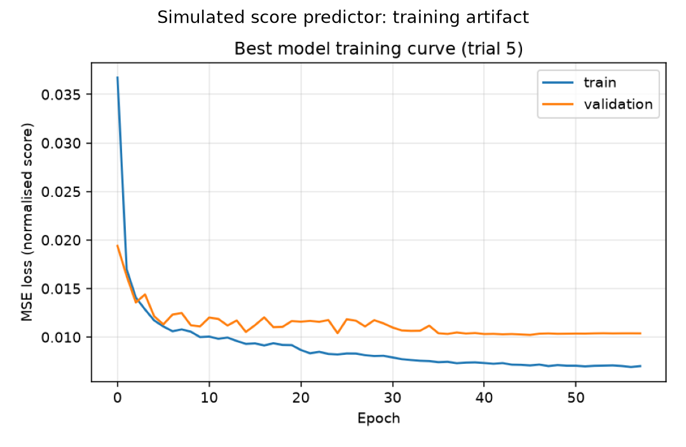
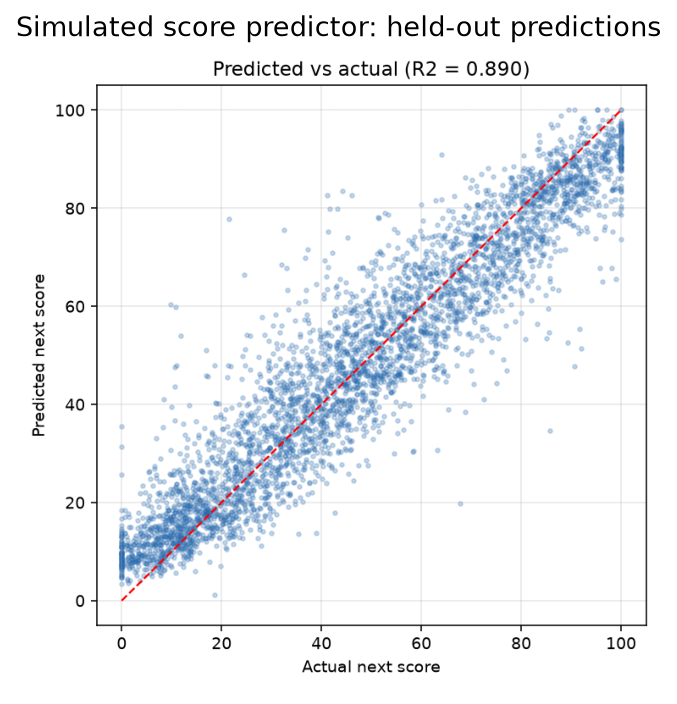
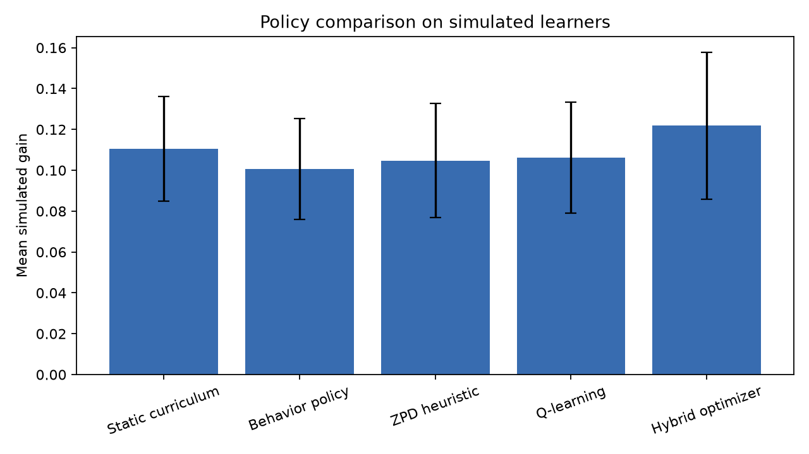
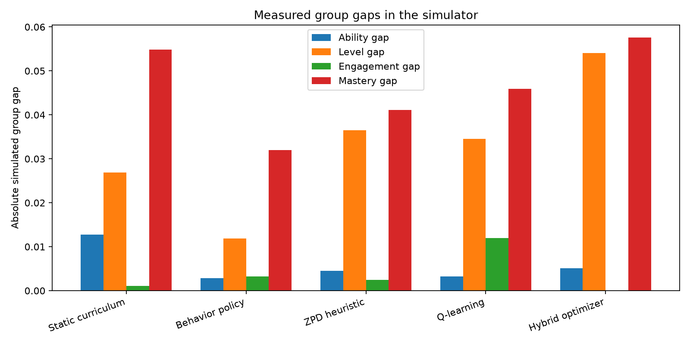
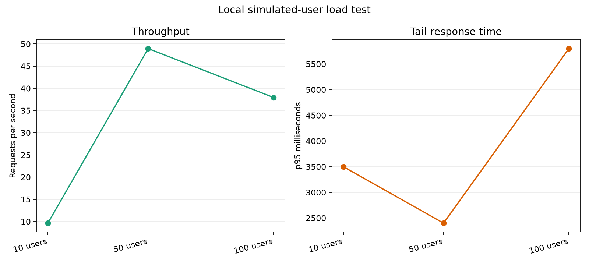
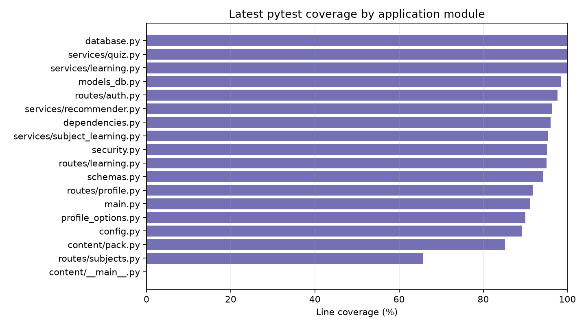
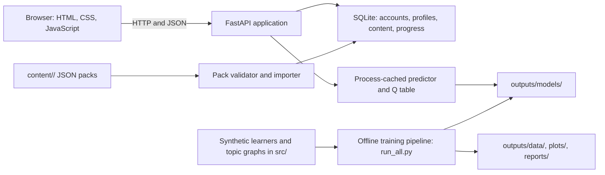

# Adaptive Learning Path Optimizer

This is a local web application for exploring personalized study recommendations. A learner can create an account, complete a short profile, choose up to eight subjects from installed packs or by typing/searching a subject, and view progress and quizzes. Public-source discovery can create an unreviewed topic path with links. A FastAPI server stores data in SQLite. An offline machine-learning and reinforcement-learning pipeline trains the recommender using simulated learners.

> **What it is:** a local prototype for learning-path software and simulated recommender experiments.
>
> **What it is not:** a proven teaching product, a source of real learning materials, or a service ready for public deployment.


## 🌐 Deployed 

🔗 **Link:** https://ai-learning-path-optimizer.onrender.com
## Status and limitations

- All learners used to train and evaluate the recommender are **simulated**. These results do not prove real learning gains.
- Resource types such as `video`, `article`, and `interactive` are **labels**. The app does not provide a real library of videos or articles.
- Rule-based recall questions are generated lazily from saved, cited Wikipedia/Wikidata source data. Generated questions are unreviewed and may be limited when the source does not support at least five quality-checked items. Wikipedia-derived questions carry CC BY-SA attribution and Wikidata facts carry CC0 attribution; teachers should review questions before use.
- The online learner level is a heuristic, not a qualification. Fairness and group-gap results are simulation measurements, not evidence of real-world fairness.
- Teacher self-registration is open. Anyone can register as a teacher and edit shared content; do not expose this app to untrusted users.
- Internet subject discovery is implemented using public Wikipedia/Wikidata, Open Library, and OpenAlex endpoints. Discovered paths are unreviewed drafts, and linked Wikibooks/OpenStax/MIT OCW searches are references, not hosted course material.
- No LLM or paid API is used. Question templates only transform stored, cited Wikipedia/Wikidata sentences and facts; the generator does not invent facts. Topics without at least five accepted source questions are marked limited and skipped in the main learning flow.
- The server-side enrollment limit is eight active subjects per learner. The limit is protected by a process-local lock and is not a cross-process database constraint.
- The checked-in model artifacts load in hybrid mode on the current tested setup. `/ready` reports the active recommender mode. Training and evaluation remain simulation-only.
- This project is for local learning and demonstration. See [the validation report](docs/VALIDATION_REPORT.md) before deciding whether it is suitable for a classroom or deployment.

## Contents

- [Features](#features)
- [Screenshots](#screenshots)
- [Results](#results)
- [Architecture](#architecture)
- [How the recommender works](#how-the-recommender-works)
- [Assignment mapping](#assignment-mapping)
- [Quick start](#quick-start)
- [Configuration](#configuration)
- [Tests and quality checks](#tests-and-quality-checks)
- [Project structure](#project-structure)
- [Content packs and adding a subject](#content-packs-and-adding-a-subject)
- [Teacher guide](#teacher-guide)
- [Privacy and data](#privacy-and-data)
- [Troubleshooting](#troubleshooting)
- [Limitations and roadmap](#limitations-and-roadmap)
- [License](#license)

## Features

### Onboarding

- Register and sign in with a username and password.
- Complete a consent screen and minimal learner profile before using learning features.
- Choose 1–8 subjects from installed packs, enter a manual subject, or search public sources; remove subjects to free a slot.
- Preview public-source topic paths before adding them. Later subject changes are available from the dashboard.
- Edit or delete the profile. Account deletion removes the account and its associated learning data.
- Choose a country and curriculum from data in `content/learner-profile/options.json`.

### Subjects and content packs

- Enroll in, switch between, and leave subjects.
- Keep progress and history separate for each learner and subject.
- New accounts start with no enrolled subjects. The onboarding pack list shows regular packs by default and exposes the Mathematics, Python Programming, and Physics examples through an explicit sample-subject option.
- Import validated JSON packs or use discovery to create a subject. Selecting an uninstalled pack installs and enrolls it on demand. `make import-content` imports every valid pack idempotently, including the examples.

### Adaptive recommendations

- Rank eligible activities using a trained predictor and Q table when compatible artifacts are available.
- Filter topics whose prerequisites are not ready.
- Explain score prediction, difficulty fit, engagement, prerequisite readiness, and coverage.
- Use a prerequisite-aware zone-of-proximal-development (ZPD) fallback if model files are unavailable.

### Quizzes and diagnostics

- Start a short diagnostic after the source-backed path is ready; topics without enough quality-checked questions are skipped.
- Get one question at a time, with the existing predictor, Q-learning and prerequisite rules used to select subsequent topics and difficulty. Questions are not repeated in a session.
- Submit answers to the server for grading; the correct option is withheld until grading. Wrong answers show the cited source sentence and link.
- Pack enrollment attempts to attach public-source material to its path. Pack questions without an eligible internet-source bank are not used in the primary quiz flow.
- Report questionable items for teacher review; teachers can edit, approve, or delete questions.
- Reuse previously seen questions only after the source-backed learner bank is exhausted, and tell the learner when reuse occurs.

### Progress and weakness view

- View per-topic mastery estimates, prerequisite availability, recommendations, and recent history.
- Store a separate estimated level and learning goal for each subject.
- Review data-backed weak-topic tips, score history, prerequisites, and cited learning links.

### Teacher tools

- Use teacher-only API routes to create or update topics, resources, and questions.
- Review drafted questions and content. Teacher self-registration is a known security limitation.

### Security

- Store password hashes rather than passwords and use signed access and refresh tokens.
- Apply rate limits to registration, login, and account deletion.
- Add response security headers, validate request bodies, and grade quizzes on the server.
- Delete an account and its saved profile, subject states, history, enrollments, and refresh tokens.
- Apply HTTPS provider allowlists, public-DNS checks, response-size/time limits, no-redirect fetching, short-lived caching, and process-local rate limits to discovery requests.

## Screenshots

The checked-in examples are generated by `python -m scripts.capture_screenshots`. The script launches a local test server with a temporary SQLite database and a disposable account.

- [Sign-in page](docs/images/sign-in.png) — signed-out landing page.
- [Onboarding form](docs/images/onboarding.png) — required profile and consent screen.
- [Diagnostic](docs/images/diagnostic.png) — one question per Mathematics topic; no answer key is shown.
- [Dashboard](docs/images/dashboard.png) — Mathematics subject selector, topic map, mastery chart, and recommendations.
- [Quiz](docs/images/quiz.png) — activity questions and answer controls.

To capture them again, install Chromium with `playwright install chromium`, then run the script above. Do not use a real account or database for screenshot capture.

## Results

These charts use checked-in training/evaluation artifacts, the latest Task 6 report, the Phase F steady-state load table, and the most recent local pytest coverage data. Learner-model results are simulated. Load-test durations differ by user count; a separate 50-user restart test is reported in the validation report and is not steady state. Rebuild the images after changing those inputs with `python -m scripts.make_readme_plots` (run pytest first for the coverage chart).



*Training and validation loss for the checked-in simulated score predictor.*



*Held-out predicted and actual scores for simulated learners; this is not a real-student evaluation.*



*Mean simulated gain and standard deviation for five policies in the Task 6 experiment.*



*Measured group gaps in one simulated evaluation; the chart does not establish real-world fairness.*



*Requests per second and p95 time in local steady-state runs; a separate 50-user test covers server restart and persistence.*



*Line coverage by application module from the latest local pytest run.*

The exact run conditions, errors, limitations, and historical results are recorded in [docs/VALIDATION_REPORT.md](docs/VALIDATION_REPORT.md).

## Architecture



More detail is in [docs/ARCHITECTURE.md](docs/ARCHITECTURE.md).

## How the recommender works

1. The offline simulator makes synthetic learners and random prerequisite topic graphs. It creates example activity histories and simulated quiz scores.
2. The predictor estimates a likely next score from topic mastery, prerequisite readiness, difficulty gap, engagement, score trend, attempts, resource type, time, learner level, and goal.
3. A Q-learning table estimates the longer-term value of abstract actions: a resource-type label and a difficulty step.
4. The hybrid ranker combines predicted score, normalized Q value, estimated engagement, difficulty fit, and a coverage term. The score is a ranking heuristic, not a measured learning gain.
5. Prerequisite rules remove ineligible topics before ranking. If the model artifacts cannot be loaded, the ZPD fallback ranks the remaining choices.

The policy comparisons and all learner outcomes are simulated. They test software behavior; they do not prove that real learners improve.

## Assignment mapping

| Task | Main files | Evidence |
|---|---|---|
| 1 — Problem analysis | `src/task1_problem_analysis.py`, `src/feature_schema.py` | [Task 1 report](outputs/reports/task1_problem_analysis.md) |
| 2 — Data transformation | `src/data_generation.py`, `src/domain.py`, `src/task2_preprocessing.py` | [Task 2 report](outputs/reports/task2_preprocessing.md) |
| 3 — Predictive model | `src/task3_model.py`, `src/task2_preprocessing.py` | [Task 3 report](outputs/reports/task3_model.md) |
| 4 — Reinforcement learning | `src/task4_qlearning.py`, `src/q_table.py`, `src/env.py` | [Task 4 report](outputs/reports/task4_rl.md) |
| 5 — Optimizer | `src/task5_optimizer.py`, `app/services/recommender.py` | [Task 5 report](outputs/reports/task5_optimizer.md) |
| 6 — Evaluation | `src/task6_evaluation.py`, `src/task5_optimizer.py` | [Task 6 report](outputs/reports/task6_evaluation.md) |
| 7 — Conclusion | `src/task7_conclusion.py` | [Task 7 report](outputs/reports/task7_conclusion.md) |

See [docs/ASSIGNMENT_MAPPING.md](docs/ASSIGNMENT_MAPPING.md) for cross-task platform support and evidence notes.

## Quick start

Use a supported Python version for the pinned dependencies. The current validation environment uses Python 3.14.7; TensorFlow installation can vary by operating system and processor. These commands are for a fresh local checkout:

```bash
python3 -m venv .venv
source .venv/bin/activate
python -m pip install --upgrade pip
python -m pip install -r requirements.txt -r requirements-dev.txt
cp .env.example .env
```

Open `.env` and replace `APP_SECRET=replace-me` with a private random value of at least 32 characters. Keep it stable while using the same database. Do not share or commit `.env`.

The pipeline regenerates synthetic data, model artifacts, plots, and reports under `outputs/`. It does not modify the app database. Back up any generated artifacts you need to retain before training. Then run:

```bash
make train
make migrate
make import-content
make run
```

`make import-content` idempotently imports every valid pack, including examples under `content/examples/`. New student accounts start with no subjects; choose one or more during onboarding. Example packs are hidden unless "Include sample subjects" is selected. Onboarding also installs a selected uninstalled pack on demand. Open <http://127.0.0.1:8000/> for the web app. FastAPI Swagger is available at <http://127.0.0.1:8000/docs>; the OpenAPI document is at <http://127.0.0.1:8000/openapi.json>. Stop the foreground server with Ctrl+C.

The command `make migrate` creates or updates `outputs/app.db`. Back up an existing database before migrations. Validation and screenshot scripts use temporary databases; never point them at your personal app database.

## Configuration

The application reads these variables from the environment. In development it also loads `.env` from the project root.

| Variable | Default | Required in production? | What it does |
|---|---|---:|---|
| `APP_ENV` | `development` | Yes | Selects development or production configuration checks. |
| `APP_SECRET` | Unset; development uses a random process-only key | **Yes** | Signs access and refresh tokens. Production requires a private value of at least 32 characters. |
| `DATABASE_URL` | SQLite file at `<project-root>/outputs/app.db` | Yes | SQLAlchemy database URL. PostgreSQL is not a tested or packaged deployment configuration. |
| `ACCESS_TOKEN_MINUTES` | `15` | No | Access-token lifetime in minutes. |
| `REFRESH_TOKEN_DAYS` | `7` | No | Refresh-token lifetime in days. |
| `ALLOWED_ORIGINS` | Empty list | For cross-origin browser access | Comma-separated origins allowed by CORS. The `.env.example` includes local development origins. |

The current environment example is [`.env.example`](.env.example). `APP_SECRET=replace-me` is only a placeholder; replace it before using the app beyond a disposable local run.

## Tests and quality checks

```bash
source .venv/bin/activate
playwright install chromium
pytest
ruff check .
ruff format --check .
mypy
pre-commit run --all-files
```

The Playwright browser test requires Chromium. Tests use temporary databases. `mypy` with the repository configuration is the supported check; the broader command `mypy app src` currently reports untyped third-party numerical/model libraries and additional inference issues, listed in [PROJECT_STATE.md](PROJECT_STATE.md).

For the offline load test, run `VALIDATION_LOAD_SECONDS=30 python tests/validation/run_load_validation.py`. The script includes a planned restart in the 50-user phase. The browser and validation helpers are described in [docs/VALIDATION_REPORT.md](docs/VALIDATION_REPORT.md).

## Project structure

```text
.
├── app/                 # FastAPI routes, database models, schemas, and services
├── content/             # Subject packs and learner-profile options, stored as data
├── migrations/          # Alembic database migrations
├── docs/                # Architecture, API, data, security, and validation guides
├── outputs/
│   ├── data/            # Synthetic learner, resource, and interaction data
│   ├── models/          # Generated predictor pipelines, model, metadata, and Q table
│   ├── plots/           # Offline training and evaluation plots
│   └── reports/         # Generated assignment reports
├── scripts/             # Screenshot and README-chart utilities
├── src/                 # Simulator, training, optimizer, and evaluation pipeline
├── static/              # Browser interface and locally served Chart.js
├── tests/               # Unit, API, migration, browser, and validation tests
├── run_all.py           # Generates data, trains models, and writes reports
├── run_server.py        # Starts the local web server
├── Makefile             # setup, train, migrate, run, test, lint, and clean helpers
└── requirements*.txt    # Pinned runtime and development dependencies
```

Do not publish `outputs/app.db`; it may contain account hashes and learner history. The database is ignored by Git.

## Content packs and adding a subject

Regular packs are JSON data in `content/<subject-id>/content.json`; sample packs are under `content/examples/<subject-id>/content.json`. A pack describes a subject, ordered topics, prerequisite edges, resource labels and descriptions, and questions with answer keys and explanations. The validator checks pack structure and prerequisite consistency. Included quiz questions are drafts that need teacher review.

To add and import a subject:

1. Copy an existing directory such as `content/examples/physics/` to `content/my-subject/`.
2. Edit its JSON and use a unique subject ID and unique topic, resource, and question IDs.
3. Keep prerequisite references within the same subject and ensure the graph has no cycles.
4. Mark questions for review and include at least two answer choices, a valid `correct_option`, and an explanation.
5. Validate and import the pack with:

   ```bash
   python -m app.content import content/my-subject
   ```

Import is transactional and can update matching IDs when re-run. `make import-content` imports all valid built-in packs idempotently; adding a new valid folder makes it available in onboarding as not installed until selected. Invalid pack folders appear as onboarding errors and are logged by the server. Review pack changes before importing them into a database with real data. See [the data dictionary](docs/DATA_DICTIONARY.md) and [architecture guide](docs/ARCHITECTURE.md).

Internet discovery returns short summaries and source links only. Discovered subjects are labeled **Draft / auto-built from public sources, unreviewed**. Books can be attached as references; the app stores metadata and links, not book text. A manually entered subject can remain empty or be enriched from a selected public-source outline. See [the discovery API](docs/API.md#subject-discovery).

To manually try the real public search providers against a running local server, run `python scripts/try_discovery.py --query "astronomy"`. The helper prompts for a local account and prints candidate metadata and citations; no API keys are required. Automated tests mock providers and do not access the internet.

To inspect up to 20 rule-based questions from saved public Wikipedia material for a subject, run `.venv/bin/python scripts/try_questions.py "Python"`. This preview makes live requests to Wikipedia, needs no API key, and prints the answer and evidence for local quality review. It reports clearly if the provider is offline or no candidate questions pass the filters.

## Teacher guide

The UI currently provides teacher role sign-up only through the public registration API; this is not safe access control for a shared service. For a disposable local demo, create a teacher account through the register route, then use the documented teacher endpoints in [docs/API.md](docs/API.md) to create or edit topics, resources, and questions. Teacher changes affect shared subject content. Back up the database and review content before use. Do not give teacher access to untrusted users.

## Privacy and data

The app stores usernames, bcrypt password hashes, learner profile choices, per-subject mastery estimates, and activity history in SQLite. It does not request age, date of birth, full name, or institution name. The under-18/unknown-age message is a notice only; age and guardian consent are not verified. The profile level is an estimate based on self-report and a small diagnostic.

Account and profile deletion are available; account deletion also removes that learner's owned manual/discovered subject paths and references. Before using real student data, establish a retention policy, access controls, backup and restore procedures, and jurisdiction-appropriate privacy/consent review. See [docs/SECURITY.md](docs/SECURITY.md). All ML/RL training and evaluation data remains simulated.

## Troubleshooting

- **Port 8000 is busy:** stop the other local server, or run `python -m uvicorn app.main:app --host 127.0.0.1 --port 8001`.
- **Model files are missing, incompatible, or corrupt:** inspect `/ready` for the active mode. The app uses its prerequisite-aware ZPD fallback when the trained artifacts cannot be loaded. Back up `outputs/models/` before `make train`; training replaces generated artifacts.
- **The progress chart is blank:** check that `/static/chart.umd.min.js` loads. The chart is served locally, not from a CDN. If it fails, the dashboard shows a fallback message and the topic map remains available.
- **TensorFlow will not install:** compatibility depends on Python version, macOS architecture, and the pinned TensorFlow release-candidate package. Try the project’s supported Python environment or consult TensorFlow’s platform support. Training code includes a scikit-learn fallback when TensorFlow cannot be imported.
- **You forgot `APP_SECRET`:** development can start without it, but its generated key changes on restart and invalidates existing tokens. For production, set a private stable value of at least 32 characters.
- **The API says tables are missing:** run `make migrate` against the intended local database. Make a protected backup first if that database has data.
- **Registration cannot find Mathematics:** run `make import-content` after migrations and before registering.
- **Recommendation is slow on first use:** model initialization occurs on the first model-using request. Call `/ready` before a local demo. The measured 100-user latency is still high; this project is not a capacity-tested service.
- **SlowAPI emits a deprecation warning:** the warning currently comes from the pinned SlowAPI dependency calling deprecated `asyncio.iscoroutinefunction`; it is documented as an open dependency issue.

## Limitations and roadmap

Current limits include simulated learner evidence and RL training, unreviewed discovery drafts and generated questions, recall-style question coverage, public teacher self-registration, process-local rate limits and enrollment locking, browser-local token storage, slow first model initialization, high p95 latency in the 100-user local test, and open `mypy app src` diagnostics. Public content is untrusted and may be incomplete or wrong. See [PROJECT_STATE.md](PROJECT_STATE.md) and [docs/VALIDATION_REPORT.md](docs/VALIDATION_REPORT.md) for current status.

Future work, not implemented today:

- LLM agents for curriculum and content drafting.
- More teacher-reviewed subjects and real resources.
- A supervised pilot with appropriate consent, privacy review, and real outcome measures.
- Trusted teacher provisioning, production database/operations, and validated accessibility.

## License

This project is licensed under the [MIT License](LICENSE). The copyright notice names Chandan Kumar Sah.
