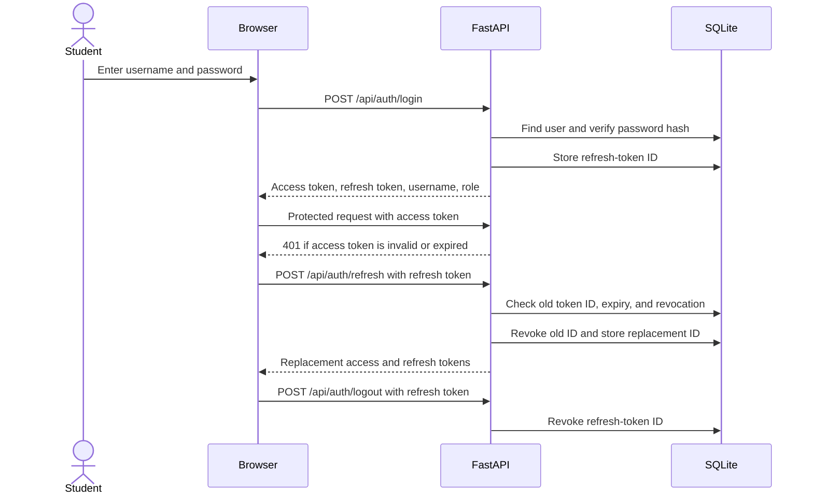
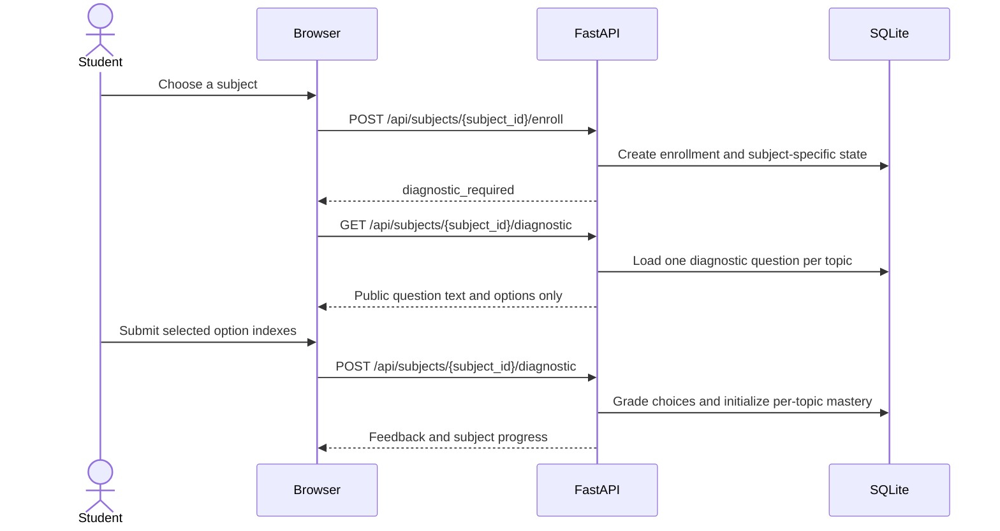
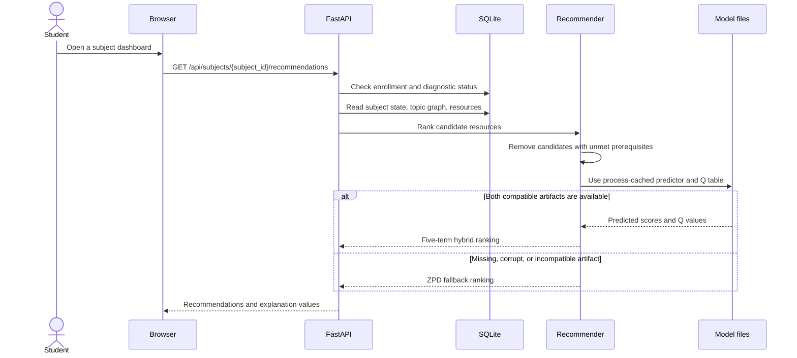
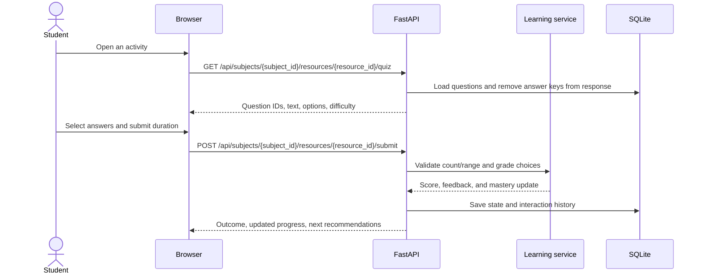

# Architecture

## Components and responsibilities

- `static/` holds the browser UI, local JavaScript/CSS, and Chart.js.
- `app/main.py` creates the FastAPI app, installs CORS and security headers, logs request metadata, mounts the UI, and serves health/readiness checks.
- `app/routes/auth.py` handles registration, login, refresh, logout, and account deletion.
- `app/routes/learning.py` provides compatibility routes that operate on a learner's active subject.
- `app/routes/subjects.py` handles subjects, enrollment, progress, diagnostic, quiz, recommendation, history, and teacher content writes.
- `app/services/subject_learning.py` loads per-subject content and learner state, grades quiz submissions, calculates simulated mastery updates, and filters prerequisite-blocked topics.
- `app/services/recommender.py` ranks eligible resources. It caches predictor and Q-table objects in each server process and falls back to a ZPD-based utility if either artifact is unavailable or invalid.
- `app/content/` validates JSON packs and imports subject data. `python -m app.content import content/<subject>` invokes its CLI.
- `app/models_db.py` defines users, subjects, topics, prerequisite edges, resources, questions, enrollments, per-subject student state, interactions, and refresh tokens.
- `migrations/` holds Alembic schema revisions, including a migration that carries the existing Mathematics learner state into subject-scoped records.
- `src/` builds synthetic examples across generated topic graphs, trains the predictor and Q table, and evaluates policies. `run_all.py` runs the offline pipeline; the web server does not train models at startup.
- `content/` contains the Mathematics, Python Programming, and Physics draft packs. Their quiz questions are marked for teacher review.
- `outputs/` contains generated CSVs, model artifacts, plots, reports, and the default local database. The model files and reports are generated data; they should not be described as validated against real learners.

## Login, refresh, and logout



Registration issues the same token pair as login. Registration and login are limited to five attempts per minute per client IP. Refresh tokens rotate on refresh. Logging out revokes refresh capability; an already-issued access token remains usable until its expiry.

## Subject enrollment and diagnostic



Correct option indexes are omitted from the question responses. A diagnostic can be completed once per enrollment. Each enrollment has separate progress even when the same learner switches subjects.

## Recommendation flow



The prerequisite mastery threshold is `0.6`. Topics whose prerequisites are below that threshold are removed before either ranking method runs. The API's hybrid utility is:

```text
U = 0.25 * predicted_score
  + 0.25 * normalized_Q_value
  + 0.18 * engagement
  + 0.17 * difficulty_fit
  + 0.15 * coverage
```

All five terms are scaled to approximately `0..1`. Predicted score is the model's output divided by 100 and clipped to that range. Q values are normalized over eligible candidates; an unseen state/action has an initial Q value of `0.5`. Engagement is the average of the learner's engagement moving average and the resource-type prior. Difficulty fit is the zone-of-proximal-development Gaussian fit using candidate-topic mastery and resource difficulty. Coverage is larger for low mastery or low engagement and rewards a useful difficulty range and interactive/project formats. These are heuristic weights, not weights established through a real-world study.

If either model artifact is missing, corrupt, or not compatible with the current feature layout, the runtime uses:

```text
U_fallback = 0.60 * difficulty_fit
           + 0.25 * (1 - candidate_topic_mastery)
           + 0.15 * coverage
```

The fallback still obeys prerequisite filtering. `GET /ready` and the compatibility endpoint `GET /api/meta` report the active mode. The checked-in predictor metadata and Q table use the generalized feature schema; the current validation environment reports `hybrid`. Missing, corrupt, or incompatible artifacts select the fallback.

## Quiz submission



The request contains selected option indexes, not a score. The server grades the submitted answers and stores the resulting score and state update. Activity duration is client-reported, validated to `0.5..120` minutes, and cannot be independently verified by the server. The current service accepts repeat quiz submissions; it does not implement one-time quiz attempts.

## Teacher content flow

Teacher routes require a user whose role is `teacher`. They can create or update topics, resources, and questions. Prerequisite changes are checked for duplicates, cross-subject edges, self-dependencies, and cycles. Teacher self-registration is public in the current app, however, so this role check does not prevent an arbitrary visitor from creating a teacher account.

The pack importer validates the full JSON document and imports it transactionally. Re-importing a pack updates matching content records rather than duplicating them. Packs are data; application code does not contain a separate branch for each subject.

## Design decisions and trade-offs

- **SQLite by default:** it is easy to run locally and supports the demo's transactional writes. The file-backed connection pool is set to 40 connections for the tested synchronous server setup after the default pool timed out in a 100-user run. The post-change run had no observed database-lock errors, but its p95 latency remained high. This does not establish production capacity or prove PostgreSQL is required. PostgreSQL has not been set up or load-tested here.
- **Process-local model cache:** loading models only once per process reduces repeated disk and deserialization work. Each server worker has its own cache and memory copy. Replacing artifacts requires a process restart to take effect.
- **Server-side grading:** answer keys stay out of student-facing quiz payloads and scores cannot be directly supplied by the browser. Duration remains client-reported.
- **Relational content, JSON learner maps:** topics, resources, questions, and prerequisites have relational tables. Per-subject mastery and attempts are stored as JSON text maps keyed by topic ID, which makes content packs flexible but limits database-level validation of those maps.
- **Simulation:** the offline pipeline avoids collecting real learner data, but its simulated outcomes are only useful for checking program behavior. They are not evidence of real educational benefit or fairness.
- **Development teacher registration:** easy for a local demonstration, but unsuitable for shared or public deployments. A trusted provisioning flow and audit trail are needed before deployment.
